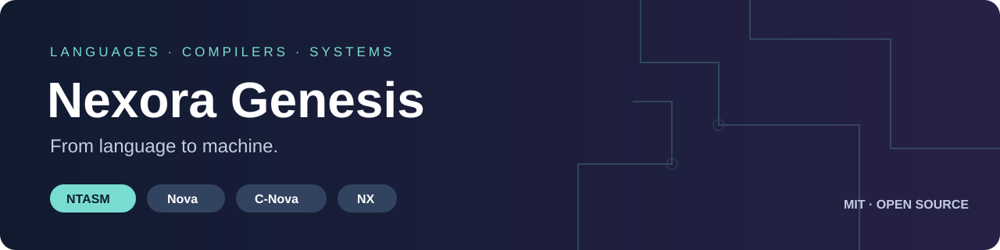
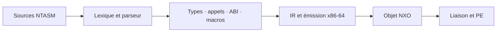

<p align="center"></p>

# Nexora Genesis

**Un assembleur typé, des compilateurs et des langages pour construire des systèmes.**

[Démarrer](docs/guides/ntasm-quickstart.md) · [Explorer le compilateur](compiler/README.md) · [Spécifications](spec/README.md) · [Roadmaps](#roadmaps) · [Validation](VALIDATION.md) · [Licence MIT](LICENSE)

> **Édition de recherche — 22 octobre 2026.** Le compilateur principal fonctionne encore avec un bootstrap C. La relève en Nova progresse, mais A8 et A9 restent ouverts : cette copie n'est pas annoncée comme une livraison B2.1 achevée.

## Trouver ce que l'on cherche

| Dossier | Rôle |
|---|---|
| [`compiler/c/`](compiler/c/README.md) | Implémentation C actuellement utilisée pour construire le compilateur principal |
| [`compiler/nova/`](compiler/nova/README.md) | Modules Nova : frontend, types, appels, ABI, macros, IR, x86-64, NXO et PE |
| [`compiler/runtime/`](compiler/runtime/README.md) | Exécution Nova et hôte UEFI natif |
| [`tests/`](tests/README.md) | Tests, cas négatifs et programmes de contrôle, séparés des implémentations |
| [`spec/`](spec/README.md) | Contrats de langage, formats et cible x86-64 |
| [`docs/`](docs/README.md) | Guides d'usage, architecture et état des jalons |
| [`examples/os/`](examples/os/README.md) | Exemples OS et démonstrations, conservés hors de `legacy/` |
| [`tools/`](tools/README.md) | Outils utiles à la copie actuelle |
| [`bootstrap/`](bootstrap/README.md) | Description du seed minimal ; les anciens bootstrap sont archivés |
| [`legacy/`](legacy/README.md) | Anciennes implémentations et outils de campagne, hors du build normal |

## De la source à l'exécutable



Le backend C est la voie principale actuelle. Le backend MIR charge des modules Nova. Les deux chemins ne constituent pas deux preuves équivalentes : leurs tests et limites sont décrits dans [VALIDATION.md](VALIDATION.md).

## Première lecture

```ntasm
module bootstrap.return42
target x86_64-nexora-uefi
section .text {
    export fn main() -> u64
    effects {}
    clobbers {rax} {
        return 42;
    }
}
```

Cet exemple est conservé dans [`examples/ntasm-v0/c-bootstrap/return42.ntasm`](examples/ntasm-v0/c-bootstrap/return42.ntasm). Les exemples ne remplacent pas la [spécification](spec/ntasm/ntasm.md).

## Construire

Sous Linux ou WSL avec Bash, GCC et les outils GNU :

```bash
bash scripts/ntbuild.sh policy
bash scripts/ntbuild.sh pins --verify
bash scripts/ntbuild.sh build
```

**La vérification des empreintes signale encore trois écarts hérités du principal.** Ils sont conservés et documentés ; ne pas les contourner pour annoncer un build officiel réussi. Le contrôle de réorganisation a néanmoins recompilé les 17 unités C et reproduit les huit sorties PE de référence. Les sorties de travail restent dans `out/`, exclu de Git.

## Roadmaps

Les cases cochées indiquent les jalons déclarés validés dans le principal, ou une preuve précisément nommée. Elles ne certifient pas que toute cette copie a été retestée. Les autres roadmaps sont des objectifs de développement, sans date ni pourcentage inventé.

### NTASM — B2.1

- [x] **A1 — Spécification et formats** : grammaire et formats figés selon le contrat actuel.
- [x] **A2 — x86-64** : encodages, adressage et relocations du périmètre v0.
- [x] **A3 — Modules et typage** : fonctions, modules et types machine.
- [x] **A4 — Contrats et ABI** : effets, clobbers et conventions d'appel.
- [x] **A5 — Macros et comptime** : expansion, hygiène et bornes.
- [x] **A6 — Stubs système** : chemins structurés et preuves QEMU enregistrées.
- [x] **A7 — Chaîne commune** : IR, objets NXO, PE et exécution enregistrée.
- [ ] **A8 — Auto-hébergement complet** : terminer le build maison, le vérifier et retirer le C du build normal.
- [ ] **A9 — Livraison utilisable** : finaliser commandes, paquet et reproductibilité après A8.
- [x] **A10 — Diagnostics et contrôles** : améliorations et comparaisons enregistrées.

Référence : [contrat B2.1](docs/status/ntasm-completion.md). **Avant le push de cette édition :** valider les trois écarts d'empreintes et revoir la réorganisation ; ne pas cocher A8 sur la seule réussite d'un lot.

### Nova — une chaîne autonome

- [x] Observer un point fixe du compilateur Nova : P1 et P2 identiques sur les sources du 21 octobre.
- [x] Produire le pilote NTASM avec P2 et vérifier son corpus de 19 cas dans le laboratoire.
- [ ] Terminer la reconstruction complète sur le runtime maison, sans traduction des sources par C.
- [ ] Rejouer les preuves depuis une copie propre, avec les nouveaux chemins du dépôt.
- [ ] Faire de cette chaîne le build normal et déplacer le bootstrap C hors des dépendances requises.
- [ ] Figer la grammaire, les interfaces du runtime et la bibliothèque minimale de la prochaine version Nova.
- [ ] Mesurer les coûts de compilation et corriger les lenteurs avec des cas reproductibles.
- [ ] Définir et valider séparément les besoins GPU avant d'annoncer un compilateur GPU utilisable.

### C-Nova — programmation système

- [ ] Définir précisément le périmètre CPU/système et sa différence avec Nova et NTASM.
- [ ] Écrire la grammaire, les règles de types, de mémoire et d'interopérabilité.
- [ ] Construire une première verticale : source → IR commune → exécutable testé.
- [ ] Ajouter les fonctions, structures, modules et accès mémoire prévus par la spécification.
- [ ] Valider un petit composant système avec cas positifs et négatifs.
- [ ] Documenter les garanties et les opérations explicitement non sûres.

### NX — applications et outils

- [ ] Figer les premiers usages et le contrat d'exécution.
- [ ] Définir les types, modules, erreurs et interfaces avec Nova/C-Nova.
- [ ] Relier un frontend minimal à la chaîne commune.
- [ ] Livrer un programme d'application complet et reproductible.
- [ ] Ajouter bibliothèque, diagnostics, outils et guide utilisateur au rythme des usages validés.

### MEM et scheduler — pistes à spécifier

- [ ] **MEM** : préciser le besoin que les langages existants ne couvrent pas déjà.
- [ ] Définir régions, durées de vie, permissions et interfaces mémoire à tester.
- [ ] Comparer un prototype à une implémentation de référence avant de promettre un gain.
- [ ] **Scheduler** : définir le modèle de tâches, les contraintes temporelles et les invariants.
- [ ] Valider d'abord le modèle dans un simulateur, puis dans un exemple OS contrôlé.

L'ordre de priorité reste **NTASM A8 → A9 → consolidation Nova → nouveaux langages**. Ces pistes ne signifient pas que MEM ou un langage de scheduler sont déjà implémentés.

## Licence et contribution

Cette édition du code original et de sa documentation est proposée sous **[MIT](LICENSE)** : utilisation gratuite, y compris commerciale, avec conservation des mentions exigées. Les licences propres aux composants tiers restent applicables. Voir [LICENSING.md](LICENSING.md).

Projet développé avec l'aide d'IA. Une preuve historique, un fichier généré ou une case cochée ne remplacent pas un test reproductible sur la version que l'on publie.
