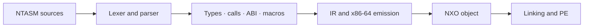

<p align="center"></p>

# Nexora Genesis

**A typed assembler, compilers, and languages for building systems.**

[Getting started](docs/guides/ntasm-quickstart.md) · [Explore the compiler](compiler/README.md) · [Specifications](spec/README.md) · [Roadmaps](#roadmaps) · [Validation](VALIDATION.md) · [MIT License](LICENSE)

> **Research snapshot — October 22, 2026.** The main compiler still relies on a C bootstrap. Its Nova replacement is progressing, but A8 and A9 remain open: this snapshot is not a completed B2.1 release.

## Find your way around

| Directory | Purpose |
|---|---|
| [`compiler/c/`](compiler/c/README.md) | C implementation currently used to build the main compiler |
| [`compiler/nova/`](compiler/nova/README.md) | Nova modules: frontend, types, calls, ABI, macros, IR, x86-64, NXO, and PE |
| [`compiler/runtime/`](compiler/runtime/README.md) | Nova execution support and native UEFI host |
| [`tests/`](tests/README.md) | Tests, negative cases, and verification programs, separate from implementations |
| [`spec/`](spec/README.md) | Language contracts, formats, and the x86-64 target |
| [`docs/`](docs/README.md) | Usage guides, architecture, and milestone status |
| [`examples/os/`](examples/os/README.md) | OS examples and demos, kept outside `legacy/` |
| [`tools/`](tools/README.md) | Tools supporting the current snapshot |
| [`bootstrap/`](bootstrap/README.md) | Minimal seed description; older bootstraps are archived |
| [`legacy/`](legacy/README.md) | Earlier implementations and campaign tools, outside the normal build |

## From source to executable



The C backend is the current primary path. The MIR backend loads Nova modules. These paths do not provide equivalent validation evidence: their tests and limitations are described in [VALIDATION.md](VALIDATION.md).

## A first example

```ntasm
module bootstrap.return42
target x86_64-nexora-uefi
section .text {
    export fn main() -> u64
    effects {}
    clobbers {rax} {
        return 42;
    }
}
```

This example is available in [`examples/ntasm-v0/c-bootstrap/return42.ntasm`](examples/ntasm-v0/c-bootstrap/return42.ntasm). Examples do not replace the [specification](spec/ntasm/ntasm.md).

## Building

On Linux or WSL with Bash, GCC, and GNU tools:

```bash
bash scripts/ntbuild.sh policy
bash scripts/ntbuild.sh pins --verify
bash scripts/ntbuild.sh build
```

**Source hash verification still reports three discrepancies inherited from the main working tree.** They remain documented and visible; bypassing them would not establish a successful official build. The reorganization check nevertheless recompiled all 17 C translation units and reproduced the eight reference PE outputs. Generated files belong in `out/`, which is excluded from Git.

## Roadmaps

Checked boxes represent milestones recorded as validated in the main working tree, or a specifically identified proof. They do not certify that this entire snapshot has been retested. The other roadmaps describe development goals, without invented deadlines or completion percentages.

### NTASM — B2.1

- [x] **A1 — Specification and formats:** grammar and formats frozen under the current contract.
- [x] **A2 — x86-64:** instruction encodings, addressing, and relocations within the v0 scope.
- [x] **A3 — Modules and typing:** functions, modules, and machine-level types.
- [x] **A4 — Contracts and ABI:** effects, clobbers, and calling conventions.
- [x] **A5 — Macros and comptime:** expansion, hygiene, and enforced bounds.
- [x] **A6 — System stubs:** structured paths with recorded QEMU evidence.
- [x] **A7 — Shared pipeline:** IR, NXO objects, PE files, and recorded execution.
- [ ] **A8 — Complete self-hosting:** finish and validate the native build, then remove C from the normal build.
- [ ] **A9 — Usable release:** finalize commands, packaging, and reproducibility after A8.
- [x] **A10 — Diagnostics and checks:** recorded improvements and comparisons.

Reference: [B2.1 completion contract](docs/status/ntasm-completion.md). **Before declaring a usable release:** validate the three source hash discrepancies and review the reorganization. A single successful batch does not complete A8.

### Nova — an independent compiler pipeline

**A8 first.** The new design goals below are planning items only: do not start their implementation until A8 is formally validated under the B2.1 contract. A9 release work remains ahead of language expansion. Fixes required to complete A8 are still the current priority.

- [x] Observe a Nova compiler fixed point: identical P1 and P2 binaries from the October 21 sources.
- [x] Produce the NTASM driver with P2 and verify its 19-case corpus in the working environment.
- [ ] Complete the full reconstruction on the native runtime, without translating sources through C.
- [ ] Reproduce the evidence from a clean checkout using the new repository paths.
- [ ] Make this pipeline the normal build and remove the C bootstrap from its required dependencies.
- [ ] Freeze the grammar, runtime interfaces, and minimal library for the next Nova version.
- [ ] Measure compilation costs and address bottlenecks with reproducible cases.
- [ ] Define and validate GPU requirements separately before claiming a usable GPU compiler.

#### Design goals and acceptance criteria — after A8

- [ ] **Fast, separate and incremental compilation.** On a fixed multi-module corpus, record clean, unchanged and single-module-edit builds. An unchanged build must compile no module; an edit must rebuild only the affected dependency closure. Incremental and clean builds of the same sources must produce identical artifacts. Publish timings and peak memory over at least ten runs, with hardware and cache conditions recorded.
- [ ] **Explicit memory safety.** Specify ownership, borrowing or region rules before implementing them. Positive and negative tests must cover use-after-free, double-free, bounds and aliasing. Each forbidden case must be rejected at compilation or trapped before the invalid access, according to the documented guarantee. Unsafe operations must be explicit; the same safety corpus must pass in development and production modes.
- [ ] **Native performance with distinct build profiles.** Define development and production profiles with the same language semantics and safety guarantees. Measure compilation time, runtime, peak memory and allocation counts on fixed parsing, buffer-processing and numerical workloads. Declare the reference implementation and performance budgets before optimizing; publish results rather than claiming C++-level speed without evidence.
- [ ] **Explicit errors and useful diagnostics.** Define typed success/error results, concise propagation and explicit conversions between error types. Tests must reject an unhandled closed error variant, exercise each error path, and verify stable error codes with source locations and an actionable explanation. Propagation must not silently discard or invent an error conversion.
- [ ] **Expressive types and bounded macros.** Add algebraic data types and exhaustive matching for closed variants, with tests for missing and unreachable cases. Macro tests must detect accidental name capture, preserve expansion provenance, and reject excessive expansion at documented limits. Measure their compile-time cost on a fixed adversarial corpus.
- [ ] **Practical library interoperability.** Start with a documented C ABI boundary, not a promise to inherit Python's ecosystem. Run bidirectional C/Nova tests for scalar values, structures, buffers and error returns; specify allocation ownership and who releases each buffer. A Python bridge remains a later, separately measured goal.
- [ ] **Inspectable compilation.** Provide a reproducible way to inspect the relevant IR, emitted code and allocation/check decisions for a small program. Tests must connect those reports to the actual generated artifact, and distinguish checks removed by proof from checks disabled by an unsafe operation.

For every acceptance item, retain the source revision, command, fixture inputs, expected result and raw output. Performance comparisons use the same machine and workload; a green counter alone is not evidence that the goal is complete. No new feature implementation is started by this roadmap update.

### C-Nova — systems programming

**Blocked on A8 completion and the shared Nova foundation.** These are future acceptance targets, not implemented features or a parallel project to launch now.

- [ ] Define its CPU/systems scope and how it differs from Nova and NTASM.
- [ ] Specify the grammar, type system, memory rules, and interoperability.
- [ ] Build an initial end-to-end path: source → shared IR → tested executable.
- [ ] Add the functions, structures, modules, and memory operations defined by the specification.
- [ ] Validate a small systems component with positive and negative cases.
- [ ] Document guarantees and explicitly unsafe operations.

#### Design goals and acceptance criteria — after A8

- [ ] **A coherent systems-language contract.** Publish the grammar and the rules for types, lifetimes, errors, modules and unsafe operations, including the boundary with Nova and NTASM. Each normative rule must have a positive or negative fixture before its implementation is accepted.
- [ ] **Predictable memory and layout.** Verify structure size, alignment, field offsets and buffer layout against an independent C or NTASM consumer on each supported ABI. Allocation must be explicit or reported. Use a bounded component with a counting allocator to demonstrate its declared allocation budget; do not claim general memory safety from layout tests alone.
- [ ] **Safety without hidden runtime requirements.** Specify what the safe subset guarantees and what unsafe code must uphold. Test invalid lifetimes, bounds, aliasing and error propagation in both build profiles. A freestanding example must link and run with only its documented runtime services; record imported symbols and dependencies.
- [ ] **Reusable compilation and interoperability.** Reuse the shared IR, object formats and backend rather than introducing a second encoding implementation. Link and execute a multi-module example crossing C-Nova, Nova and NTASM boundaries, with independent checks of argument passing, return values, register preservation and error behavior.
- [ ] **Fast development, measured production performance.** Apply Nova's incremental-build checks to a fixed systems workload. Record clean and incremental build times, executable size, runtime and allocations for both profiles. Agree on the baseline and budget before optimization; retain the same safety guarantees in the optimized profile.
- [ ] **Stable interfaces and understandable failures.** Version the language and ABI contracts. Keep a compatibility corpus across releases; an incompatible change must have a documented migration or a specific diagnostic. A small real tool or systems component must demonstrate typed errors, readable diagnostics and repeatable builds before expanding the language.

### NX — applications and tools

- [ ] Establish the initial use cases and execution contract.
- [ ] Define types, modules, errors, and interfaces with Nova/C-Nova.
- [ ] Connect a minimal frontend to the shared pipeline.
- [ ] Deliver a complete, reproducible application example.
- [ ] Add libraries, diagnostics, tools, and user documentation as use cases are validated.

### MEM and scheduling — directions to specify

- [ ] **MEM:** identify a need that the existing languages do not already cover.
- [ ] Define regions, lifetimes, permissions, and memory interfaces to test.
- [ ] Compare a prototype against a reference implementation before promising performance gains.
- [ ] **Scheduler:** define the task model, timing constraints, and invariants.
- [ ] Validate the model in a simulator first, then in a controlled OS example.

The priority order remains **NTASM A8 → A9 → Nova consolidation → new languages**. These directions do not imply that MEM or a scheduling language is already implemented.

## License and contribution

This edition of the original code and its documentation is available under **[MIT](LICENSE)**: free use, including commercial use, subject to preserving the required notices. Third-party components retain their own licenses. See [LICENSING.md](LICENSING.md).

Developed with AI assistance. Historical evidence, a generated file, or a checked box does not replace a reproducible test on the version being published.

The main README is in English. Some linked specifications, guides, and historical records are still in French.
