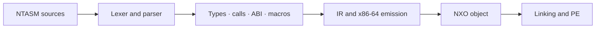

<p align="center"></p>

# Nexora Genesis

**A typed assembler, compilers, and languages for building systems.**

[Getting started](docs/guides/ntasm-quickstart.md) · [Explore the compiler](compiler/README.md) · [Specifications](spec/README.md) · [Roadmaps](#roadmaps) · [Validation](VALIDATION.md) · [MIT License](LICENSE)

> **Research snapshot — October 22, 2026.** The main compiler still relies on a C bootstrap. Its Nova replacement is progressing, but A8 and A9 remain open: this snapshot is not a completed B2.1 release.

## Find your way around

| Directory | Purpose |
|---|---|
| [`compiler/c/`](compiler/c/README.md) | C implementation currently used to build the main compiler |
| [`compiler/nova/`](compiler/nova/README.md) | Nova modules: frontend, types, calls, ABI, macros, IR, x86-64, NXO, and PE |
| [`compiler/runtime/`](compiler/runtime/README.md) | Nova execution support and native UEFI host |
| [`tests/`](tests/README.md) | Tests, negative cases, and verification programs, separate from implementations |
| [`spec/`](spec/README.md) | Language contracts, formats, and the x86-64 target |
| [`docs/`](docs/README.md) | Usage guides, architecture, and milestone status |
| [`examples/os/`](examples/os/README.md) | OS examples and demos, kept outside `legacy/` |
| [`tools/`](tools/README.md) | Tools supporting the current snapshot |
| [`bootstrap/`](bootstrap/README.md) | Minimal seed description; older bootstraps are archived |
| [`legacy/`](legacy/README.md) | Earlier implementations and campaign tools, outside the normal build |

## From source to executable



The C backend is the current primary path. The MIR backend loads Nova modules. These paths do not provide equivalent validation evidence: their tests and limitations are described in [VALIDATION.md](VALIDATION.md).

## A first example

```ntasm
module bootstrap.return42
target x86_64-nexora-uefi
section .text {
    export fn main() -> u64
    effects {}
    clobbers {rax} {
        return 42;
    }
}
```

This example is available in [`examples/ntasm-v0/c-bootstrap/return42.ntasm`](examples/ntasm-v0/c-bootstrap/return42.ntasm). Examples do not replace the [specification](spec/ntasm/ntasm.md).

## Building

On Linux or WSL with Bash, GCC, and GNU tools:

```bash
bash scripts/ntbuild.sh policy
bash scripts/ntbuild.sh pins --verify
bash scripts/ntbuild.sh build
```

**Source hash verification still reports three discrepancies inherited from the main working tree.** They remain documented and visible; bypassing them would not establish a successful official build. The reorganization check nevertheless recompiled all 17 C translation units and reproduced the eight reference PE outputs. Generated files belong in `out/`, which is excluded from Git.

## Roadmaps

Checked boxes represent milestones recorded as validated in the main working tree, or a specifically identified proof. They do not certify that this entire snapshot has been retested. The other roadmaps describe development goals, without invented deadlines or completion percentages.

### NTASM — B2.1

- [x] **A1 — Specification and formats:** grammar and formats frozen under the current contract.
- [x] **A2 — x86-64:** instruction encodings, addressing, and relocations within the v0 scope.
- [x] **A3 — Modules and typing:** functions, modules, and machine-level types.
- [x] **A4 — Contracts and ABI:** effects, clobbers, and calling conventions.
- [x] **A5 — Macros and comptime:** expansion, hygiene, and enforced bounds.
- [x] **A6 — System stubs:** structured paths with recorded QEMU evidence.
- [x] **A7 — Shared pipeline:** IR, NXO objects, PE files, and recorded execution.
- [ ] **A8 — Complete self-hosting:** finish and validate the native build, then remove C from the normal build.
- [ ] **A9 — Usable release:** finalize commands, packaging, and reproducibility after A8.
- [x] **A10 — Diagnostics and checks:** recorded improvements and comparisons.

Reference: [B2.1 completion contract](docs/status/ntasm-completion.md). **Before declaring a usable release:** validate the three source hash discrepancies and review the reorganization. A single successful batch does not complete A8.

### Nova — an independent compiler pipeline

- [x] Observe a Nova compiler fixed point: identical P1 and P2 binaries from the October 21 sources.
- [x] Produce the NTASM driver with P2 and verify its 19-case corpus in the working environment.
- [ ] Complete the full reconstruction on the native runtime, without translating sources through C.
- [ ] Reproduce the evidence from a clean checkout using the new repository paths.
- [ ] Make this pipeline the normal build and remove the C bootstrap from its required dependencies.
- [ ] Freeze the grammar, runtime interfaces, and minimal library for the next Nova version.
- [ ] Measure compilation costs and address bottlenecks with reproducible cases.
- [ ] Define and validate GPU requirements separately before claiming a usable GPU compiler.

### C-Nova — systems programming

- [ ] Define its CPU/systems scope and how it differs from Nova and NTASM.
- [ ] Specify the grammar, type system, memory rules, and interoperability.
- [ ] Build an initial end-to-end path: source → shared IR → tested executable.
- [ ] Add the functions, structures, modules, and memory operations defined by the specification.
- [ ] Validate a small systems component with positive and negative cases.
- [ ] Document guarantees and explicitly unsafe operations.

### NX — applications and tools

- [ ] Establish the initial use cases and execution contract.
- [ ] Define types, modules, errors, and interfaces with Nova/C-Nova.
- [ ] Connect a minimal frontend to the shared pipeline.
- [ ] Deliver a complete, reproducible application example.
- [ ] Add libraries, diagnostics, tools, and user documentation as use cases are validated.

### MEM and scheduling — directions to specify

- [ ] **MEM:** identify a need that the existing languages do not already cover.
- [ ] Define regions, lifetimes, permissions, and memory interfaces to test.
- [ ] Compare a prototype against a reference implementation before promising performance gains.
- [ ] **Scheduler:** define the task model, timing constraints, and invariants.
- [ ] Validate the model in a simulator first, then in a controlled OS example.

The priority order remains **NTASM A8 → A9 → Nova consolidation → new languages**. These directions do not imply that MEM or a scheduling language is already implemented.

## License and contribution

This edition of the original code and its documentation is available under **[MIT](LICENSE)**: free use, including commercial use, subject to preserving the required notices. Third-party components retain their own licenses. See [LICENSING.md](LICENSING.md).

Developed with AI assistance. Historical evidence, a generated file, or a checked box does not replace a reproducible test on the version being published.

The main README is in English. Some linked specifications, guides, and historical records are still in French.
